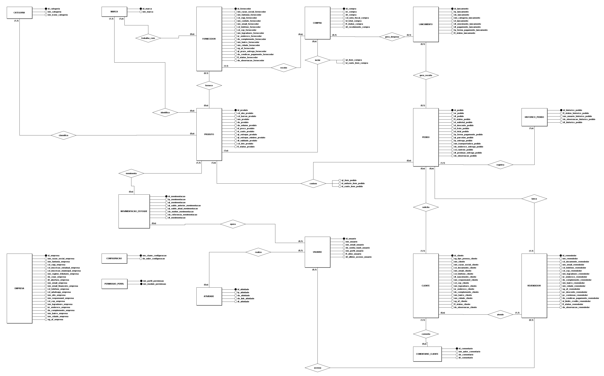

# Banco de dados do Nexo ERP

Banco: **PostgreSQL**. API: **Java com Spring Boot** (pasta `api/`).

| Modelo | Arquivo |
|---|---|
| Conceitual (brModelo) | [`brmodelo/nexo-modelo-conceitual.brM3`](brmodelo/nexo-modelo-conceitual.brM3) |
| Lógico (brModelo) | [`brmodelo/nexo-modelo-logico.brM3`](brmodelo/nexo-modelo-logico.brM3) |
| Físico (SQL) | [`../api/src/main/resources/db/migration/V1__esquema_inicial.sql`](../api/src/main/resources/db/migration/V1__esquema_inicial.sql) |

Os `.brM3` abrem no **brModelo 3.3** (Arquivo > Abrir). O lógico é gerado a partir do SQL, então os três modelos sempre batem. Para regenerar depois de mudar o banco, ver [`brmodelo/gerador/README.md`](brmodelo/gerador/README.md).

---

## 1. Modelo conceitual

17 entidades e 18 relacionamentos. Atributo com círculo preenchido é identificador.

Leitura das principais regras (a cardinalidade fica junto da entidade a que se refere):

- **Como o pedido acontece:** o cliente pede ao revendedor por fora do sistema (WhatsApp etc.). No site, o **revendedor** entra com a conta dele e **lança** o pedido, escolhendo o cliente e os produtos. Por isso o pedido tem sempre 1 revendedor (*lanca*) e 1 cliente (*solicita*).
- Cada **cliente** pertence à carteira de 1 revendedor (*atende*: revendedor (1,1), cliente (0,n)).
- Cada **revendedor** pode ter 1 conta de **usuário** com perfil Revendedor (*acessa*, 1:1). O módulo Revendedores (cadastro, desconto, crédito) é só do Administrador.
- **Pedido** e **produto** são N:N pelo relacionamento *contém*, com os atributos quantidade, preço unitário e custo do momento da venda.
- **Compra** e **produto** são N:N pelo relacionamento *inclui*, com quantidade e custo.
- **Fornecedor** e **marca** são N:N (*trabalha com*).
- Cada pedido gera no máximo 1 lançamento de receita (*gera receita*) e cada compra gera no máximo 1 lançamento de despesa (*gera despesa*). Há lançamentos avulsos (aluguel, salários).
- Toda entrada, saída ou ajuste de estoque vira uma **movimentação** do produto (*movimenta*), feita por um usuário (*opera*).
- **Usuário** realiza atividades (log) e opera movimentações de estoque.
- **Empresa**, **configuração** e **permissão do perfil** são entidades isoladas (dados do sistema).

## 2. Modelo lógico

20 tabelas, 200 colunas e 21 chaves estrangeiras. As N:N viraram as tabelas associativas `fornecedor_marca`, `item_compra` e `item_pedido`, com chave primária composta.

---

## 3. Padrão de nomes (mnemônicos)

Tabelas no singular. Colunas com prefixo mnemônico e sufixo com o nome da tabela (ex.: `nm_produto`, `vl_preco_produto`). A chave estrangeira mantém o nome da chave primária de origem (ex.: `produto.id_categoria`).

| Prefixo | Significado | Exemplo |
|---|---|---|
| `id_` | identificador (chave) | `id_produto` |
| `cd_` | código ou documento | `cd_sku_produto`, `cd_cnpj_fornecedor`, `cd_cep_cliente` |
| `nm_` | nome ou texto curto | `nm_cliente`, `nm_email_usuario` |
| `ds_` | descrição ou texto longo | `ds_observacao_pedido` |
| `nr_` | número | `nr_pedido`, `nr_endereco_cliente` |
| `sg_` | sigla | `sg_uf_cliente`, `sg_tipo_pessoa_cliente` |
| `vl_` | valor em reais | `vl_preco_produto` |
| `pc_` | percentual | `pc_desconto_revendedor` |
| `qt_` | quantidade | `qt_estoque_produto` |
| `dt_` | data ou data e hora | `dt_pedido` |
| `tp_` | tipo (lista fechada) | `tp_movimentacao`, `tp_forma_pagamento_pedido` |
| `fl_` | situação ou flag | `fl_status_pedido`, `fl_ativo_usuario` |

## 4. Decisões de modelagem

| Decisão | Motivo |
|---|---|
| Categoria e marca viraram tabelas | Evita "Shampoo" e "shampoo" como categorias diferentes e permite agrupar nos relatórios |
| Cliente na carteira de 1 revendedor (`cliente.id_revendedor` obrigatório) | O revendedor atende os próprios clientes e só deve ver os dele |
| CPF/CNPJ único por revendedor (`UNIQUE (id_revendedor, cd_documento_cliente)`) | A mesma pessoa pode comprar de dois revendedores; cada um a cadastra na sua carteira |
| Pedido com revendedor e cliente obrigatórios | Quem lança o pedido no site é o revendedor, sempre para um cliente da carteira |
| Revendedor com conta de usuário (`usuario.id_revendedor`, 1:1) e perfil Revendedor | Permite ao revendedor entrar no site; uma regra (CHECK) exige o vínculo só nesse perfil |
| Comentário do cliente guarda o nome do autor | Registro histórico, igual ao histórico do pedido |
| Sem herança (especialização) entre produto, revendedor e cliente | Herança vale para "é um tipo de"; aqui é dependência de existência, que as cardinalidades já mostram |
| Produto ligado ao pedido, não direto ao revendedor | O revendedor vende produtos por meio dos pedidos; a ligação direta duplicaria informação |
| Preço e custo copiados no item do pedido | O preço do produto muda; o pedido antigo precisa manter o valor da venda |
| Estoque atual em `produto.qt_estoque_produto` e histórico em `movimentacao_estoque` | Consulta rápida do saldo e rastreio de cada entrada e saída |
| Movimentação guarda a origem como texto (`ds_referencia_movimentacao`, ex.: "Pedido #1023") | É o que o sistema já faz e evita duas chaves estrangeiras opcionais |
| Histórico do pedido guarda o nome de quem mudou o status | Registro histórico: continua certo mesmo se o usuário for renomeado ou desativado |
| Endereço em colunas na própria tabela | Cada cliente, revendedor, fornecedor e a empresa têm um endereço só |
| Senha guardada como hash BCrypt (`ds_senha_hash_usuario`) | Hoje a senha fica em texto puro no navegador |
| Revendedores fora de `permissao_perfil` | Regra do grupo: o módulo é exclusivo do Administrador |
