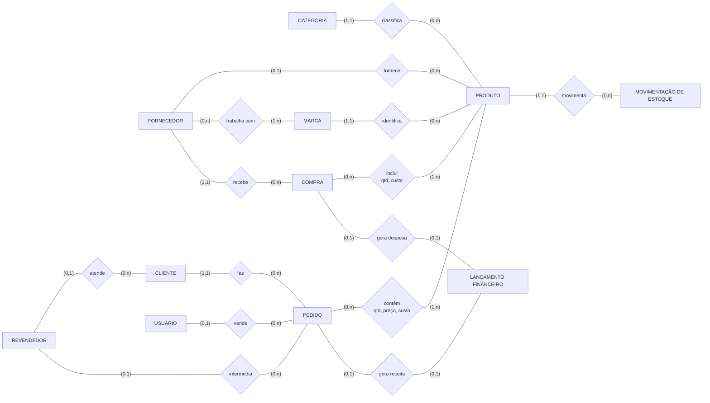
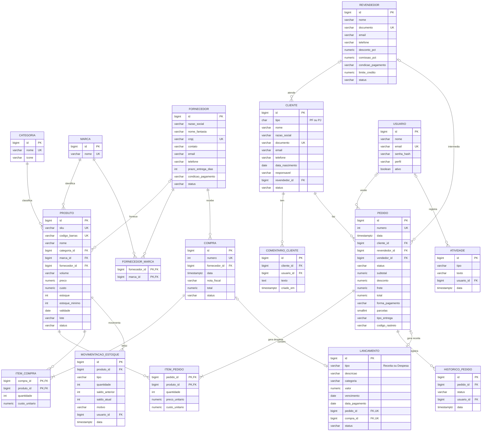

# Banco de dados do Nexo ERP

Banco: **PostgreSQL**. API: **Java com Spring Boot** (pasta `api/`).
O esquema real fica em `api/src/main/resources/db/migration/V1__esquema_inicial.sql` (modelo físico) e é criado pelo Flyway quando a API sobe.

Os diagramas abaixo são desenhados pelo GitHub (Mermaid). Para a apresentação, dá para refazer os dois no brModelo seguindo exatamente estas entidades e cardinalidades.

---

## 1. Modelo conceitual

Entidades (retângulos), relacionamentos (losangos) e cardinalidades (mínima, máxima).

Leitura das principais regras:

- Um **cliente** tem no máximo 1 revendedor; um **revendedor** atende vários clientes (1:N).
- **Pedido** e **produto** são N:N, resolvido pela entidade associativa **item do pedido** (quantidade, preço e custo do momento da venda).
- **Compra** e **produto** também são N:N, resolvido por **item da compra**.
- Fornecedor e marca são N:N (um fornecedor vende várias marcas e uma marca pode vir de vários fornecedores).
- Cada pedido gera 1 lançamento de receita; cada compra gera 1 lançamento de despesa. Existem lançamentos avulsos (aluguel, salários).
- Toda venda, compra recebida ou ajuste vira uma **movimentação de estoque**, com saldo anterior e atual (rastreabilidade).

Entidades de apoio (fora do diagrama para não poluir): EMPRESA (uma linha), CONFIGURAÇÃO, PERMISSÃO DO PERFIL, COMENTÁRIO DO CLIENTE, HISTÓRICO DO PEDIDO e ATIVIDADE (log).

---

## 2. Modelo lógico

PK = chave primária, FK = chave estrangeira, UK = valor único. Endereço aparece como colunas (cep, logradouro, numero, complemento, bairro, cidade, uf) nas tabelas que têm endereço.

Tabelas de apoio sem relacionamento no diagrama: `empresa` (uma linha só), `configuracao` (chave e valor JSON) e `permissao_perfil` (perfil, módulo).

---

## 3. Decisões de modelagem

| Decisão | Motivo |
|---|---|
| Categoria e marca viraram tabelas | Evita "Shampoo" e "shampoo" como categorias diferentes e permite filtrar e agrupar nos relatórios |
| Cliente com no máximo 1 revendedor (FK em `cliente`) | É como o sistema funciona hoje: na tela de cliente se escolhe um revendedor ou nenhum |
| Produto ligado ao pedido, não direto ao revendedor | O revendedor vende produtos por meio dos pedidos; a ligação direta duplicaria informação |
| Preço e custo copiados no item do pedido | O preço do produto muda; o pedido antigo precisa manter o valor da venda |
| Estoque atual em `produto.estoque` e histórico em `movimentacao_estoque` | Consulta rápida do saldo e rastreio de cada entrada e saída |
| Senha guardada como hash BCrypt | Hoje a senha fica em texto puro no navegador |
| Revendedores fora de `permissao_perfil` | Regra do grupo: o módulo é exclusivo do Administrador |
